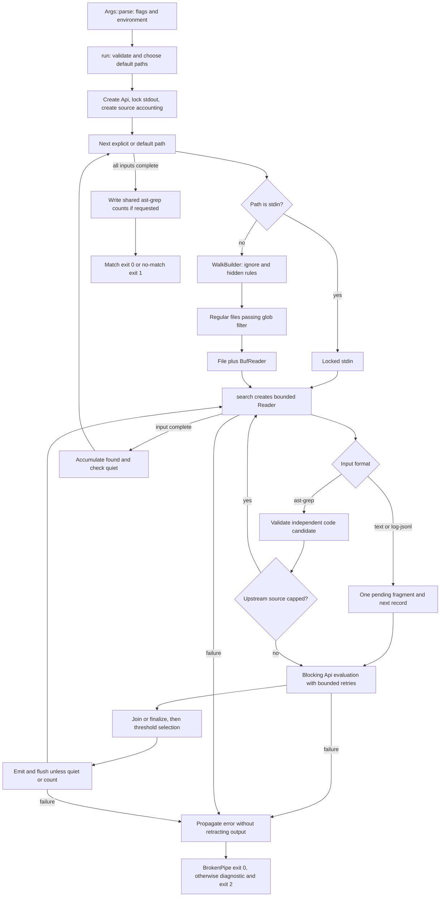

# CLI runtime and ownership boundaries

`jev-grep` is a local streaming CLI with remote model inference, not a repository search service. The binary entrypoint is `src/main.rs`; `run` owns discovery and the invocation, `search` owns evaluation and selection for one physical input, `Reader` owns record decoding and coordinates, and `Api` owns HTTP transport. External `ast-grep` and `agrind` preparation belongs to explicit shell pipelines: the CLI does not spawn either tool internally. There is no repository index, persistent search state, or response cache. Repeated input is evaluated again unless selection limits suppress inference. See [code candidates](../workflows/code-candidates.md), [log fragments](../workflows/log-fragments.md), and the [Zen API boundary](../integrations/zen-api.md).

## Invocation flow

*Runtime flow grounded in `main::run`, `search::search`, `input::Reader`, and `Api::send`; validation, traversal, and file-opening failures also propagate to the same error exit.*

The diagram is a control-flow summary, not a task graph: inputs and inference calls run sequentially. The `ignore` walker uses `build`, not a parallel walker, and `Api` uses `reqwest::blocking::Client`. A subsequent evaluation does not begin until the preceding evaluation, including any retries, returns. Directory visitation order is not explicitly sorted by this runtime; do not treat it as a stable presentation contract. [Sources: main](../../src/main.rs#L82-L204), [search](../../src/search.rs#L52-L221), [transport](../../src/api.rs#L25-L185).

## Parsing, configuration, and startup

`main` calls `Args::parse()` before entering `run`. Clap owns required arguments, typed parsing, accepted input/output formats, help/version, and declared option conflicts. Runtime validation then rejects empty or whitespace-only query/model, non-finite or out-of-range thresholds, invalid byte limits, zero timeout, zero `--max-count`, duplicate stdin paths, and incompatible output options. In particular, `--no-filename` is rejected because located output always identifies its source; `--json` together with `--format` is rejected in `run`.

For the three environment-enabled settings, precedence is **explicit flag → `JEV_GREP_*` environment variable → compiled default**:

| Setting | Environment | Fallback |
| --- | --- | --- |
| `--api-url` | `JEV_GREP_API_URL` | `https://opencode.ai/zen/v1/systemone` |
| `--model` | `JEV_GREP_MODEL` | `jev-1.13` |
| `--api-key` | `JEV_GREP_API_KEY` | No bearer token |

Old `LG_*` variables are not read. Other controls are CLI settings: input defaults to `text`, human output is the fallback, both thresholds default to `0.5`, both byte limits to `16384`, and timeout to `30` seconds per evaluation, not per invocation. Prefer the API-key environment variable over a flag to avoid shell-history exposure. This runtime does not load a configuration file. [Sources: arguments and validation](../../src/main.rs#L13-L118), [precedence tests](../../tests/test_cli.py#L80-L131).

If no paths were supplied, a terminal stdin selects `.` and a non-terminal stdin selects `-`. Explicit paths replace that default; `-` may occur at most once, but may coexist with files/directories. Each input uses the chosen invocation-wide format—there is no content sniffing. `Api::new` validates the endpoint before input processing: only HTTP/HTTPS are accepted, URL credentials are rejected, and redirects and automatic reqwest retries are disabled. Actual POSTs happen only during evaluation. Input text is disclosed to this configured endpoint. [Sources: startup](../../src/main.rs#L111-L135), [API construction and requests](../../src/api.rs#L25-L107).

## Discovery and physical input ownership

For every non-stdin path, `run` builds an `ignore::WalkBuilder`. Hidden entries are excluded unless `--hidden` is set; symbolic links are not followed. `--no-ignore` disables `.ignore`, Git ignore/global/exclude rules, and parent ignore processing. Non-regular-file entries are skipped. Glob overrides are built relative to the current working directory, then applied as a file-level exclusion check **after** walker traversal; they are not installed on the walker. Consequently a glob does not itself restore a file already excluded by hidden/ignore traversal. Invalid globs, walker errors, and file-open errors abort the invocation. Files are opened read-only and wrapped in `BufReader`; stdin is locked directly. [Source: discovery](../../src/main.rs#L125-L179).

`search` constructs a fresh `Reader` per physical input. It resets line and byte positions to zero, reads at most `--max-line-bytes + 1` bytes to detect overflow, and counts line endings in the physical size limit. Text retains source line endings and requires UTF-8 without NUL. `log-jsonl` requires a JSON object with a string `text`, decodes that field, and rejects decoded NUL while keeping physical JSONL coordinates. `ast-grep` first reads UTF-8 JSONL transport records, then validates each native candidate and its source range before inference. See [located fragments](../concepts/located-fragments.md) for coordinate and text-basis contracts. [Sources: reader](../../src/input.rs#L129-L237), [candidate validation](../../src/input.rs#L27-L121), [dispatch](../../src/search.rs#L61-L93).

## State scopes and sequential evaluation

| Lifetime | Owner and state | Boundary that must remain intact |
| --- | --- | --- |
| Invocation | `run`: resolved `Args`, one `Api`, stdout lock, aggregate `found`, shared `CodeSourceAccounting` | Passed across every physical input; quiet can stop the whole run. |
| Physical input | `Reader`: line/byte cursor; `search`: pending fragment, saved probability, split flag, local selected count and `found` | Text/log fragments never join across input boundaries. |
| Upstream code source | Shared accounting: first-seen source vector and file-name-to-slot `HashMap` | Counts, caps, and listing deduplication follow candidate `file`, not JSONL transport filename. |
| Evaluation | Request body, deadline, attempt number, response bytes and parsed answers | Retries stay inside one evaluation; no partial group result escapes. |

The accounting `indexes` map is an in-memory lookup for count slots, **not a repository or semantic index**. Only source names/counts/listing flags grow with the number of upstream code sources; there is no retained corpus, persisted result store, or memoized response table. Record/fragment limits bound streaming payloads, not total invocation memory independently of source cardinality. [Sources: invocation owners](../../src/main.rs#L121-L183), [accounting and pending state](../../src/search.rs#L36-L107), [evaluation locals](../../src/api.rs#L87-L184).

For text and log JSONL, the first record receives a single-record probability. A next record that fits the fragment budget receives one grouped evaluation with four scores. Either relation score reaching `--join-threshold` joins the record and replaces the pending probability with `match_extended`. Otherwise the old fragment is finalized using its saved score and the next record starts pending with `match_next`. If extension would exceed the fragment budget, the old fragment is finalized with split metadata and the next record is evaluated independently. A record individually exceeding the budget is an error, not silently truncated. EOF finalizes pending state; idle input alone does not flush a pending fragment. Group answers are all validated before any pending fragment is updated. [Sources: assembly loop](../../src/search.rs#L132-L220), [atomic group validation](../../src/api.rs#L56-L84).

Code candidates are evaluated independently without joining or splitting. The shared source table records first-seen candidate `file` values across all transport inputs. `-m` caps selected candidates per upstream source and suppresses later inference for that source, but capped records are still parsed and size-checked. `-l` emits each matched upstream source only once but continues scanning; `-c` emits every seen source, including zero counts, in first-seen order only after all inputs complete successfully. For text/log inputs, counts and `-m` are per physical input, and `-l` stops that input at its first selected fragment. `-q` returns at the first completed selection and suppresses output for every format. [Sources: code accounting](../../src/search.rs#L83-L130), [selection modes](../../src/search.rs#L223-L345), [final code counts](../../src/main.rs#L171-L183).

## Output, failures, and process status

`run` owns one stdout lock and lends it to search/emitters; readers and transport do not publish search results. Selection is inclusive at `probability >= threshold`, reversed by `-v`. Human and JSONL representations use the same selection path. Normal selected results and filename listings are explicitly flushed; text/log count lines are flushed at input completion or an early selection limit, while code count output is deferred to invocation completion. Although `run` still computes a filename-prefix hint, `search` receives it as `_prefix`: located human output always includes source and line ranges, regardless of `-H` or `-n`. JSONL is located-fragment output, not ripgrep's event schema. [Sources: output owners](../../src/main.rs#L119-L134), [emitters](../../src/search.rs#L223-L395).

An evaluation has one timeout budget shared by up to four attempts, backoff sleeps, and response reading. Retries are limited to selected transient statuses/transport failures. Responses over 65536 bytes, malformed JSON, missing answers, and invalid probabilities fail rather than producing fallback decisions. The HTTP layer returns validated scores or an error; it does not increment selections or emit results. [Source: transport and validation](../../src/api.rs#L14-L283).

Errors propagate with `?` through search and `run`, stopping further processing. They **do not retract already flushed output**. A pending fragment is not finalized on an error path, and deferred code counts are not printed after an abort. Thus stdout may contain valid earlier results even when the overall command fails; consumers needing all-or-nothing results must stage output themselves and check status.

| Result | Exit status | Diagnostic |
| --- | --- | --- |
| At least one selected fragment/candidate | `0` | None |
| No selections, including empty input | `1` | None |
| Runtime error | `2` | `jev-grep: {error:#}` on stderr |
| Any error chain containing `io::ErrorKind::BrokenPipe` | `0` | Suppressed |

The BrokenPipe rule checks the entire error chain, not specifically stdout. It supports consumers closing a pipe early without a noisy failure. Clap handles its own parse failures and help/version exits before `run`; they do not go through the runtime diagnostic formatter. [Source: process boundary](../../src/main.rs#L186-L204).

## Safe change and validation checklist

- Keep discovery and process policy in `run`; a new input format needs both the clap accepted-values list and reader/search dispatch, with coordinate and size validation before inference.
- Preserve per-input pending state versus invocation-wide code-source accounting. Moving the table into `search` would change caps/counts/listing across transport files.
- Preserve the score-or-error boundary and explicit output flushing. Parallel inference would require a deliberate ordering and state-commit design rather than simply spawning calls.
- Treat partial stdout as part of the failure contract. Do not add an error-path pending flush or final count write accidentally.

Focused offline acceptance tests in [tests/test_cli.py](../../tests/test_cli.py) cover environment/flag precedence, walker filtering, selection modes, empty input, early streaming, and BrokenPipe. Particularly useful regressions are `test_group_retry_commits_once_and_exhaustion_does_not_flush_pending`, `test_stream_boundary_emits_before_eof`, `test_ast_grep_source_accounting_is_shared_across_input_files`, and `test_ast_grep_upstream_source_accounting_and_limit_validation`. Reader unit tests protect physical coordinates and malformed input; API unit tests protect grouped-answer validation and shared retry deadlines. See [validation](../testing/validation.md) for the broader testing workflow.
