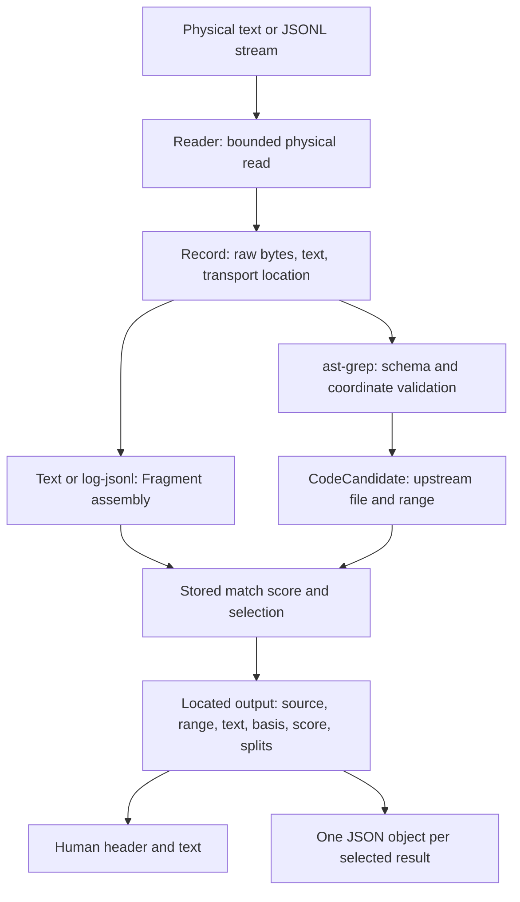

# Input records, coordinates, and located output contracts

The location contract separates **where input came from** from **what text is evaluated**. Plain text makes those two views identical. Prepared logs do not: a decoded stack trace may occupy several displayed lines while its source is one physical JSONL record. AST input introduces a third distinction: the JSONL stream transports a candidate, but the candidate's locations refer to the upstream code file.

This contract connects [runtime processing](../architecture/runtime.md), [log fragment assembly](../workflows/log-fragments.md), and [code candidates](../workflows/code-candidates.md). Its implementation boundaries are the bounded `Reader`, `Record` and `Fragment`, `parse_ast_grep`, and the emitters in `search`.


*Data flow: physical records retain transport coordinates, while validated code candidates replace them with upstream source coordinates before selection and output.*

## Physical records and decoded text

`Reader::next_record` consumes one physical line through LF, or the remaining bytes at EOF without inventing a final LF. Its counters begin at line zero and byte offset zero; each successful `Record` contains:

- `raw`: the original physical bytes, including any line ending;
- `text`: the string used for subsequent decoding or evaluation;
- `line`: the physical input line number, starting at **1**;
- `byte_range`: a **zero-based, half-open** `[start,end)` span in the input stream.

The byte end advances by `raw.len()`, not by decoded text length. Line increment, byte offset addition, and the extra-byte read limit use checked arithmetic. The CLI requires `0 < --max-line-bytes < u64::MAX` so overflow detection can reserve one extra byte.

| Input format | `Record.text` | Final evaluated text and location basis |
| --- | --- | --- |
| `text` | UTF-8 decoding of the entire physical record | Exact source text; locations refer to that input file or stdin |
| `log-jsonl` | Decoded string from the JSON object's `text` field | Joined decoded strings; locations still refer to physical JSONL records |
| `ast-grep` | UTF-8 JSON transport record | `parse_ast_grep` extracts candidate `text`; locations come from the candidate's upstream `file` and `range` |

For `log-jsonl`, the reader strips the physical LF and any trailing CR for parsing only. It requires a JSON object with a string `text`; additional fields are ignored. Escaped newlines become actual newlines in `text` without changing physical coordinates. Invalid UTF-8, binary NUL, invalid JSON, missing or wrongly typed `text`, and decoded NUL are errors. Text and AST transport records also reject invalid UTF-8 and binary NUL; AST candidate text is separately checked for decoded NUL.

`Fragment::from_record` starts with the first record's locations. Appending changes the end line and end byte to those of the new record, retaining the original start. `TextBasis` determines how strings are combined:

- **`source`**: concatenate records directly. CRLF and missing-final-LF bytes survive exactly.
- **`decoded-records`**: insert exactly one LF between decoded `text` fields. This is an added separator even if a field already ends with LF. The range describes the original JSONL records, **not** a slice of the joined string.

For example, one JSONL record containing `{"text":"PKIX\ntrace"}` produces two text lines but `start_line = end_line = 1`. A consumer must not use its byte range to slice decoded text.

Implementation and examples: [reader](../../src/input.rs), [fragment model](../../src/fragment.rs).

## Two independent size limits

Both limits default to **16384 bytes**, but apply to different representations:

| Limit | What is measured | Failure or boundary behavior |
| --- | --- | --- |
| `--max-line-bytes` | Physical bytes including LF or CRLF and JSON encoding overhead | Reject an oversized physical record before JSON decoding |
| `--max-fragment-bytes` | UTF-8 bytes of evaluated text, including inserted decoded-record separators | Reject an oversized indivisible record or candidate; split assembled logs between records when an append would exceed the limit |

The reader uses `take(max_line_bytes + 1).read_until(LF)`, retaining no more than the physical limit plus one detection byte in its raw record buffer. This bounds that read, not all process memory or transport buffering.

Log assembly checks the prospective size **before** requesting grouping scores. If the next record would exceed the fragment limit, the pending fragment completes with `split_after = true`, and the new record starts a separately scored fragment with `split_before = true`. Equality does not force completion: a fragment exactly at the limit remains pending until another boundary or EOF. A single physical text record, decoded log `text`, or AST candidate cannot be subdivided by this mechanism.

The markers describe forced size boundaries, not model-declared event boundaries. Each part is selected independently, so a visible part can carry a marker even when its neighboring part was not selected. Code candidates always have both markers `false`.

Raising the physical limit can accommodate JSON escaping and metadata without raising the evaluated-text limit. Raising the fragment byte limit does not increase the model's token context. See [CLI limit guidance](../../docs/reference.md#oversized-fragments).

## AST coordinates: validate, then convert

Native `ast-grep scan --json=stream` objects must supply string `text`, a nonempty string `file`, and `range.byteOffset`, `range.start`, and `range.end` objects. Each byte offset, line, and column must be a nonnegative integer representable as `u64`. If `language` is present it must be a string; absent language remains absent in output. Extra upstream fields such as `lines`, `labels`, and `metaVariables` are not candidate text.

Validation precedes inference and requires:

1. `start_byte <= end_byte` and `end_byte - start_byte == text.len()` in **UTF-8 bytes**.
2. Non-reversed zero-based line coordinates, with `end.line = start.line + number_of_LF_bytes_in_text`.
3. Consistent columns measured by Rust `chars()`—Unicode scalar values, not UTF-8 bytes. For a single-line candidate, `end.column = start.column + character_count(text)`; for a multiline candidate, the end column equals the character count after its last LF.
4. Checked arithmetic for line conversion and column addition.

Output byte offsets are preserved unchanged. Output lines are **1-based inclusive**:

```text
output.start_line = ast.start.line + 1
output.end_line   = ast.end.line       if text ends with LF
                    ast.end.line + 1  otherwise
```

A trailing LF puts the upstream exclusive endpoint at column zero on the next line; that next line is not included in the output's inclusive span. CRLF preserves both bytes while LF supplies the line break. For example, the native fixture's `PKIX ошибка\r\n` spans bytes `[10,29)` and zero-based positions from line 2, column 4 to line 3, column 0. Output reports lines **3–3**, bytes **10–29**, and unchanged text.

The parser validates consistency with supplied text; it does not reopen the upstream file to verify that the candidate still matches disk contents. The transport's physical line is used for diagnostics, not as the emitted code line. `file == "STDIN"` maps to a stdin source; otherwise the upstream path identifies the source even when the JSONL transport itself came from stdin.

See [AST parser](../../src/input.rs) and [native fixture](../../tests/fixtures/ast-grep-native.jsonl).

## Selection and located output

Log processing keeps one pending fragment, its criterion-match probability, and its `split_before` flag. The first record receives `match`. A fitting next record receives the four grouping questions together: `same_event`, `useful_context`, `match_next`, and `match_extended`. Either relation score reaching `--join-threshold` joins the record and replaces the stored score with `match_extended`. A declined join emits the old fragment using its saved score and starts the next with `match_next`. EOF completes any pending log fragment.

Code candidates bypass log grouping: each evaluated candidate receives its own match score and can be emitted without waiting for transport EOF. Selection uses stored probability **≥ `--threshold`**, or **below** it with `--invert-match`; output format does not change selection.

`--format json` emits JSONL, not a JSON array or ripgrep event stream. Each selected result has:

| Field | Contract |
| --- | --- |
| `kind` | `log` or `code` |
| `source` | `{"kind":"file","path":"..."}` or `{"kind":"stdin","path":null}` |
| `range` | `start_line`, `end_line`: 1-based inclusive; `start_byte`, `end_byte`: zero-based half-open UTF-8 byte boundaries in the identified source |
| `text` | Evaluated fragment or upstream candidate text |
| `text_basis` | `source` or `decoded-records`; code always uses `source` |
| `probability` | Stored criterion-match score, not a grouping relation score |
| `split_before`, `split_after` | Forced size boundaries; always present |
| `language` | Optional, code-only upstream language string; omitted when absent |

JSON serialization escapes embedded newlines but does not append one to the `text` value. Human rendering always prints a source and line-range header. Code headers additionally print `bytes start-end`; decoded log headers say `(JSONL line coordinates)` and forced splits add `[split-before]` or `[split-after]`. Both human emitters append a final LF **only for display** when text lacks one. They do not otherwise normalize CRLF or alter stored text.

`-n` and `-H` are accepted compatibility flags, not switches enabling locations: locations are mandatory without them. `--no-filename` is rejected. `--json` aliases JSON output but conflicts with any `--format`; scripts using the former `path/line_number/text/probability` schema must migrate. Count, list, and quiet modes are mutually exclusive and reject explicit output formats; they do not emit located result bodies.

In code mode, counts, listing deduplication, and `-m` caps belong to the upstream path across all transport files, not to each JSONL input. Candidates after a path reaches its cap are still parsed and size-validated, but not sent for inference. Other paths continue processing.

Errors stop processing with exit code 2; previously emitted results remain on stdout, but an unfinished log fragment is not flushed as a successful completion. Normal outcomes use 0 for any selected result and 1 for none. Broken downstream pipes are handled without a BrokenPipe diagnostic.

Output implementation: [search and emitters](../../src/search.rs); option and exit handling: [CLI entrypoint](../../src/main.rs).

## Tests and safe changes

The focused checks in [input unit tests](../../src/input.rs#L240-L334) cover exact CRLF/Unicode/source slicing, EOF without LF, decoded newlines retaining physical coordinates, malformed records, and coordinate overflow. [CLI integration tests](../../tests/test_cli.py) cover joined locations, saved selection scores, human/JSON equivalence, forced split markers, upstream AST text and language, immediate candidate streaming, invalid byte/column ranges rejected before HTTP, and source caps across transports. These are contract tests rather than assessments of model quality; see [validation](../testing/validation.md).

When extending an input format, explicitly choose which source the emitted range indexes and whether evaluated text is an exact source slice or a decoded representation. Keep physical size validation before decoding, candidate validation before inference, and selection separate from presentation. Changing newline joining, Unicode column counting, or source identity is a consumer-visible contract change—not merely a formatting refactor.
