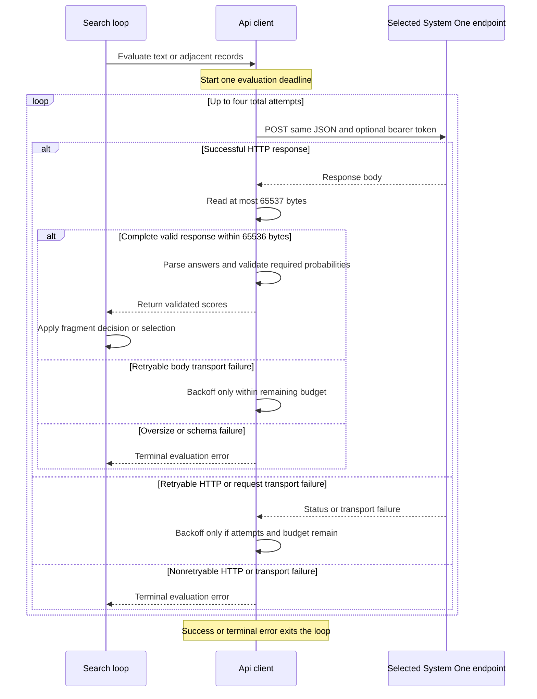

# Zen System One protocol, credentials, and bounded retries

`jev-grep` sends semantic evaluations to a complete System One endpoint. The blocking `Api` client owns HTTP construction, authentication, bounded transport retries, and response validation. The search loop owns fragment decisions and output; it receives validated probabilities rather than interpreting raw gateway responses. See [Runtime](../architecture/runtime.md), [Log fragments](../workflows/log-fragments.md), and [Code candidates](../workflows/code-candidates.md) for the surrounding workflows.

## Configuration and credential boundary

| Setting | Flag | Environment | Default |
|---|---|---|---|
| Complete endpoint URL | `--api-url` | `JEV_GREP_API_URL` | `https://opencode.ai/zen/v1/systemone` |
| Explicit model ID | `--model` | `JEV_GREP_MODEL` | `jev-1.13` |
| Optional bearer token | `--api-key` | `JEV_GREP_API_KEY` | None |
| Per-evaluation timeout in seconds | `--timeout` | No corresponding environment binding | `30` |

Flags override environment values, which override defaults. The old `LG_*` variables are not supported. The model must be nonblank and the timeout positive. Endpoint parsing accepts only `http` or `https` and rejects embedded URL usernames/passwords: use the bearer-key setting instead. The URL is used as supplied, not as a base URL to which the client appends a route. There is **no automatic endpoint or model fallback**. For example, `jev-1.13-free` is an explicit model override, not an emergency substitute.

The binary supports bearer authentication directly: when a key is present, every attempt adds `Authorization: Bearer …`; otherwise it sends no bearer header. It does not resolve a keychain entry or require fnox at runtime. Prefer environment injection over `--api-key`, since command arguments can expose secrets through shell history or process inspection. HTTP is permitted for mock/custom endpoints, so choose HTTPS when transmitting real credentials or sensitive data.

### Optional fnox keychain launch

The repository's [fnox configuration](../../fnox.toml) defines a `zen-keychain` provider of type `keychain`, service `jev-grep`, and a `JEV_GREP_API_KEY` secret reference with `if_missing = "error"`. It contains no API key. `env = "exec"` makes the launcher-based workflow explicit. `root = true` stops parent-project configuration discovery but does not disable fnox global configuration.

From the repository root:

```sh
fnox set JEV_GREP_API_KEY --provider zen-keychain
fnox exec -- jev-grep --json 'Certificate validation failure' sample.log
```

Run `fnox set` without a secret value argument so it prompts with hidden input. The documented Linux setup needs an available, unlocked Secret Service; headless or SSH sessions may need local keyring preparation. In this workflow, missing credentials or an unavailable keychain must fail **before launching the child**. There is deliberately no plaintext fallback, and substituting an empty key is not a recovery procedure. Direct binary invocation remains available, for example against an explicitly configured mock endpoint; that does not supply the normal Zen credential setup. See [Deployment](../../docs/deployment.md) for operating instructions.

## Request and answer contract

Every evaluation POSTs JSON with three fields: `model`, `state`, and `questions`. Each question is typed as `{"type":"noul","instructions":"…"}`. The criterion is sent in question instructions, not evaluated locally.

For a single record or code candidate, `state` is a string and `questions` contains just `match`:

```json
{
  "model": "jev-1.13",
  "state": "certificate validation failed for service alpha\n",
  "questions": {
    "match": {
      "type": "noul",
      "instructions": "Certificate validation failure"
    }
  }
}
```

For an adjacent-record assessment, `state` is an object with string fields `current_fragment` and `next_record`. One logical evaluation asks all four questions together:

| Answer ID | Instruction meaning |
|---|---|
| `same_event` | Does the next record continue the same concrete event? Shared topic alone is insufficient. |
| `useful_context` | Does it materially explain, qualify, resolve, or contradict the current fragment with respect to the criterion? Independently matching the criterion is insufficient. |
| `match_next` | Evaluate only the next record, ignoring the current fragment. |
| `match_extended` | Evaluate the current fragment followed by the next record as one fragment. |

A successful response must be JSON with an `answers` object. Required answer values are nested numeric probabilities, for example:

```json
{
  "answers": {
    "same_event": {"noul": 0.1},
    "useful_context": {"noul": 0.9},
    "match_next": {"noul": 0.2},
    "match_extended": {"noul": 0.8}
  }
}
```

Each required `answers.<id>.noul` must parse as an `f64`, be finite, and lie in the inclusive range `[0, 1]`. Strings such as `"0.5"`, booleans, missing values, and out-of-range numbers are errors. Extra answers are not needed and do not replace required ones.

`group_probabilities` validates **all four answers before returning any scores**. Only after success does search append the record or emit a boundary and install the next pending fragment. Either relation score reaching `--join-threshold` permits a join, using `match_extended` as the new relevance score; a declined join preserves the old fragment's saved score and uses `match_next` for the new fragment. A partial response cannot trigger a partial fragment decision. Search may temporarily take the pending value out of its local slot while evaluating, but an evaluation error aborts the search without flushing that pending fragment. This is not an all-run output transaction: already emitted output is not rolled back.

## One deadline, at most four attempts

The client disables both redirects and implicit reqwest retries. Its explicit loop is the sole retry policy: **four total attempts**, including the first request, for each logical evaluation. All attempts reuse the same endpoint, body, model, and configured bearer token.

At the start of `send`, the client starts one monotonic budget from `--timeout`. Each request receives only the remaining time as its request timeout, including response-body reading. Retry waits consume the same budget; it is not reset by a retry or by incremental body arrival. A wait must be strictly shorter than the remaining budget, and elapsed time is checked again after sleeping. Thus an exhausted deadline or a long `Retry-After` can terminate before all four attempts are used. This is a per-evaluation transport budget, not a timeout for the complete search invocation.


*Request/retry sequence: transport retries stay inside one evaluation deadline, while search decisions occur only after complete answer validation.*

### Retry classification and waits

| Category | Behavior |
|---|---|
| HTTP `408`, `429`, `500`, `502`, `503`, `504`, `529` | Retry if attempts and deadline remain. |
| Request timeout | Retry subject to the same bounds. |
| Transport error whose source chain contains qualifying I/O errors | Retry for `TimedOut`, `ConnectionReset`, `ConnectionRefused`, `ConnectionAborted`, `BrokenPipe`, or `UnexpectedEof`. This also applies to body-read failures. |
| Other unsuccessful HTTP status | Terminal, including authentication/authorization errors and redirects. |
| Other transport failure | Terminal, including TLS certificate validation failure. |
| Complete malformed JSON, missing/invalid required answers, or oversized response | Terminal; no retry for a bad completed response. |

The three possible retry waits use exponential bases of **200, 400, and 800 milliseconds**, each plus uniformly chosen **0–100 ms** jitter. For retryable HTTP responses, `Retry-After` may be integer seconds or an HTTP date. The actual delay is the greater of server delay and local backoff. Invalid values fall back to local backoff; past dates add no server delay; overflowing integer delays become `Duration::MAX` and fail the budget check rather than wrapping. Non-success bodies are dropped rather than parsed as answer data.

Successful response bodies have a **64-KiB limit (65,536 bytes)**. The reader takes at most 65,537 bytes to detect an excess, then rejects oversize responses before JSON parsing. Errors distinguish terminal HTTP statuses, invalid response data, deadline exhaustion, and attempt exhaustion. Search adds source/record context; normal API failures reach stderr and exit code `2`.

## Disclosure, cost, and verification boundaries

Requests disclose the selected text and question instructions to the configured endpoint. Group requests disclose both the pending fragment and next record. Use only data you are authorized to disclose; synthetic inputs are preferable for tests. Byte-based input/fragment limits are separate from model token context limits and are not proof that a request fits an upstream context window.

A transport failure can occur **after the server has already performed inference**. Reposting the same request can therefore cause duplicate work and possible duplicate charges. The client does not provide exactly-once inference. Local validation and a single local fragment update after a successful retry do not prove a single upstream execution. Check [current Zen documentation](https://opencode.ai/docs/zen/#jev) for availability and pricing instead of treating a repository snapshot as a current price guarantee.

The tests establish the client's protocol and safety behavior, not model accuracy. [Validation](../testing/validation.md) covers the wider test strategy. Focused coverage includes:

- [Rust API tests](../../src/api.rs): request shapes and independent grouping scores, missing/invalid answers, response size and redirects, retryable statuses and `Retry-After`, identical authenticated reposts after truncated bodies, drip-fed-body deadlines, and repeated disconnects bounded by the shared deadline.
- [Offline CLI tests](../../tests/test_cli.py): environment/flag precedence, ignored legacy variables, terminal `401`, four-attempt exhaustion, no retries for malformed/oversized complete responses, grouping retry without duplicate local output, pending-fragment suppression on exhaustion, and terminal self-signed TLS certificate rejection.
- [Deployment smoke notes](../../docs/deployment.md#minimal-live-integration-smoke): a documented live single-candidate and grouped-text integration smoke, explicitly not a benchmark or model-quality result.

When changing the protocol, keep request construction, required-answer validation, retry classification, and the caller's state-update boundary aligned. A new gateway must implement this System One contract; changing only `--api-url` does not adapt arbitrary inference APIs.
