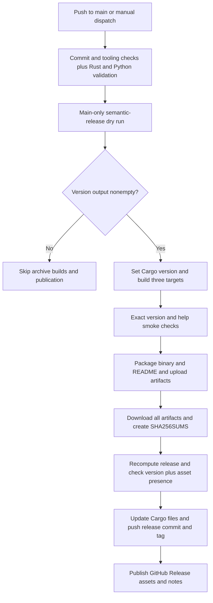

# Release pipeline and repository automation

`jev-grep` is distributed as a Rust CLI through GitHub Release archives. The repository's private npm package is **release tooling**, not an npm distribution of the CLI; the pipeline publishes neither an npm package nor a crates.io package. Installing from source remains a separate Cargo operation:

```sh
cargo install --path . --locked
```

See [Quickstart](../quickstart.md) for usage and [Runtime architecture](../architecture/runtime.md) for the client itself. The authoritative operational guide is [docs/releasing.md](../../docs/releasing.md).

## Commit history is the release input

[release.config.js](../../release.config.js) restricts semantic-release to `main`, uses tags of the form `v${version}`, and shares the Conventional Commits preset between commit analysis and release-note generation. It analyzes commits since the previous release tag, rather than requiring a manual Cargo version bump.

| Commit change | Release effect |
| --- | --- |
| `fix:` or `perf:` | Patch |
| `feat:` | Minor |
| `!` after the type/scope or a `BREAKING CHANGE: ...` footer | Major, including on a `0.x` line |
| `docs:`, `chore:`, `test:`, `ci:`, `build:`, `refactor:`, `style:` without a breaking change | No release |

The largest required bump across new commits wins. For example, a feature plus a fix produces a minor release; the generated `chore(release)` commit does not itself request another release.

[Conventional Commits](../../.github/workflows/commits.yml) runs on PR creation, synchronization, reopening, and editing. It uses full Git history to lint **both the PR title and the PR commit range** with [commitlint's conventional configuration](../../commitlint.config.js). Preserve that format in the final squash message. The release workflow also lints the pushed range on `main`; for an all-zero previous SHA, it checks the last commit instead. A manual release dispatch does not execute that push-only lint step.

For local checks, use Node.js 24.10 or newer:

```sh
npm ci
printf '%s\n' 'feat(cli): add a new output format' | npm run commitlint
npm run commitlint -- --last --verbose
npm run test:release
```

## Release lifecycle

[Release](../../.github/workflows/release.yml) starts on pushes to `main` or manual dispatch. Its concurrency group is `release-${{ github.ref }}` with `cancel-in-progress: false`: runs on the same ref are serialized rather than cancelling an active build. Planning is explicitly gated to `refs/heads/main`.


*Release lifecycle: publication depends on validated matrix artifacts and a fresh semantic-release decision, not on a separate tag-triggered workflow.*

### 1. Check before planning

The `check` job installs npm tooling, checks pushed commit messages, and runs `npm run test:release`. It then installs stable Rust with rustfmt and Clippy and runs:

```sh
cargo +stable fmt --check
cargo +stable clippy --locked --all-targets -- -D warnings
cargo +stable test --locked
cargo +stable build --locked
python3 -m unittest discover -s tests -v
```

The Python acceptance tests use a local mock HTTP API, not live model inference. Consequently release validation needs neither Zen access nor a model key and does not establish real-model accuracy. See [Validation](../testing/validation.md) for the broader test boundary.

### 2. Plan without publication

`npm run release:plan` invokes [scripts/release.mjs](../../scripts/release.mjs) in `plan` mode. It calls semantic-release with `dryRun: true` and **only** the shared analysis and notes plugins, excluding preparation, Git commits, and GitHub publication. The planned version is written as `version=...` to `GITHUB_OUTPUT`; no release produces an empty value and logs `No release needed`.

The matrix requires that output to be nonempty. When it is empty, both archive builds and the dependent publication job are skipped. The check, plan, and publish checkouts use `fetch-depth: 0`, making release tags and commit history available to analysis; the build jobs only need their source snapshot.

### 3. Build the planned version on every supported platform

Each matrix job runs [scripts/set-release-version.py](../../scripts/set-release-version.py) before `cargo +stable build --release --locked --target "$TARGET"`.

| Runner | Target | Archive suffix |
| --- | --- | --- |
| `ubuntu-24.04` | `x86_64-unknown-linux-gnu` | `.tar.gz` |
| `macos-15` | `aarch64-apple-darwin` | `.tar.gz` |
| `windows-2022` | `x86_64-pc-windows-msvc` | `.zip` |

The Linux artifact is a glibc build, not a musl build. The matrix has `fail-fast: false`, so one failing target does not immediately cancel its siblings, but publication still requires successful builds.

The version setter changes only the root package version in `Cargo.toml` and its source-less entry in `Cargo.lock`, preserving dependency versions and all other content. It accepts only stable `X.Y.Z` versions, requires a unique matching lockfile entry with the old manifest version, and validates both transformed files before writing either. Invalid input or a manifest/lockfile mismatch therefore fails before mutation; this is not a general filesystem transaction guarantee.

Every built executable must return exactly `jev-grep $RELEASE_VERSION` for `--version` and successfully run `--help`. Archives are named `jev-grep-vX.Y.Z-TARGET.tar.gz` or `.zip`, with the binary and `README.md` as members. Each job uploads `release-TARGET` artifacts and treats missing upload files as an error.

### 4. Recheck and publish

The `publish` job waits for both plan and build, downloads `release-*` artifacts into `dist`, and generates `SHA256SUMS` over the `.tar.gz` and `.zip` files. `npm run release` invokes `publish` mode, which requires `RELEASE_VERSION` to identify the version built by the matrix and reruns semantic-release with the full configuration.

Before the Git plugin can commit changes, [scripts/release-prepare.mjs](../../scripts/release-prepare.mjs) enforces two guards:

- The recomputed `nextRelease.version` must equal `RELEASE_VERSION`; otherwise publication is refused to avoid mismatched binaries.
- All three **exactly versioned** platform archives and `dist/SHA256SUMS` must exist. Only then does preparation update the publishing checkout's Cargo files.

These are presence guards, not archive-content or checksum-verification guards. Build smoke checks and checksum generation are separate earlier responsibilities.

semantic-release then commits only `Cargo.toml` and `Cargo.lock` with `chore(release): X.Y.Z [skip ci]`, creates `vX.Y.Z`, and publishes a GitHub Release with generated notes, archive assets, and checksums. GitHub success/failure comments and released labels are disabled in the plugin configuration. The wrapper treats a publication result without `nextRelease` as an error (`Planned release was not published; main may have advanced`) rather than silently accepting an obsolete plan.

Downloaded archives can be checked on Linux with:

```sh
sha256sum --ignore-missing -c SHA256SUMS
```

## Operations, recovery, and safe extension

Planning and publication use the built-in `GITHUB_TOKEN` with contents-write permission; other release jobs inherit contents-read permission. GitHub branch protection must permit the release bot to push the version commit. Making `Conventional Commits / commitlint` required and configuring squash merges to use PR titles are recommended **repository settings**, not guarantees supplied by workflow YAML.

Without an existing release tag, semantic-release starts at `1.0.0`, regardless of the Cargo manifest version. To continue an already released `0.1.x` line, tag the previously released commit as `v0.1.0` and push that tag first.

Serialization does not freeze `main`. An outdated run may fail to publish if the branch advances; a later run can handle the newer commits, or release can be manually retried on `main`. If failure occurs **after the version commit or tag was pushed**, inspect the tag and GitHub Release before retrying. semantic-release does not automatically republish an already tagged version; saved workflow artifacts can restore missing release assets.

For changes to supported platforms, keep the build matrix, archive naming, and preparation's required suffixes synchronized. Adjust the GitHub asset patterns if adding another archive format. Keep analysis and notes configuration shared between planning and publication so the two phases describe the same release decision.

[Release-tooling tests](../../scripts/release.test.mjs) cover classification and largest-bump selection, exact preservation of non-version Cargo content, harmless reapplication, invalid-input and mismatched-lockfile failure without partial writes, and preparation guards before Cargo mutation. A local bare-Git-remote integration test verifies that a dry run creates no tag, then publication commits and tags the same planned Cargo version and updates remote `main`. It does not exercise the GitHub asset upload service.

## Generated OpenWiki maintenance boundary

[OpenWiki Update](../../.github/workflows/openwiki-update.yml) runs daily at `0 8 * * *` (08:00 UTC) and on manual dispatch. This is separate from release tooling: it uses Node.js 22, installs `openwiki@0.6.1` plus Mermaid/jsdom validation dependencies, and runs `openwiki code --update --print` with configured provider/model and connector credentials.

Its checkout also requires **full history**, but for a different reason: OpenWiki must diff `HEAD` against the commit it last documented. A shallow checkout can hide that baseline and yield an empty change summary.

The update step uses `continue-on-error: true`. Unless cancelled, subsequent steps remove transient `openwiki/.run.json` and create or update a PR on `openwiki/update`, with commit and title `docs: update OpenWiki`. Staging is limited to `openwiki`, `AGENTS.md`, the update workflow, and `CLAUDE.md` only when present. The PR body reports the OpenWiki outcome; after preserving completed pages, a failed update is propagated with `exit 1`. Thus partial progress can survive in a reviewable PR without making the workflow appear successful. Merging that progress supplies the next scheduled run's baseline.

[AGENTS.md](../../AGENTS.md) treats the generated wiki as optional just-in-time context and source code/tests as authoritative. **Normally update source or docs and let OpenWiki regenerate**, rather than hand-editing generated pages, unless explicitly asked to do so.
