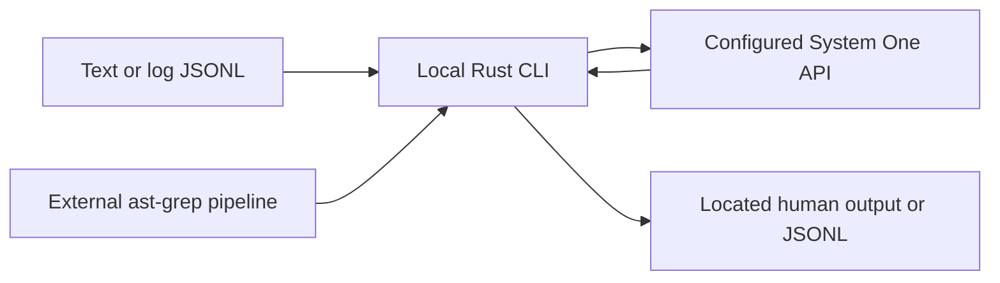

# Start here: build, run, and choose a change path

`jev-grep` is a local Rust CLI that selects **log fragments and code candidates using a natural-language criterion**. It is not an embedded model or a repository-index service: inference runs at the configured HTTP API. Input text and the criterion leave the local process. Use only data you are authorized to disclose; model selection is probabilistic, so validate criteria and thresholds on your own examples.

## Build and validate first

Run from the repository root with Rust supporting edition 2024:

```sh
cargo build --locked
./target/debug/jev-grep --help
cargo test --locked
python3 -m unittest discover -s tests -v
cargo fmt --check
cargo clippy --locked --all-targets -- -D warnings
```

The Python acceptance suite uses only the Python standard library and a local mock HTTP server, and runs `target/debug/jev-grep`; **build before running it**. These are offline behavioral checks: no Zen credentials or model weights are needed, and passing them does not establish real-model accuracy. Cargo may still need to download dependencies when they are not cached; “offline” here means no live inference dependency, not `cargo --offline`.

For an installed command rather than the debug binary:

```sh
cargo install --path . --locked
jev-grep --help
```

Do not make `npm install` a prerequisite for Rust work. [package.json](../package.json) belongs to optional **release and commit tooling**, requires Node `>=24.10.0`, and supplies `npm run test:release`. Node is not part of the Rust binary runtime. Follow [validation](testing/validation.md) for focused checks and [release automation](operations/releases-and-automation.md) for Node setup and publication changes.

## Run safely

Defaults are endpoint `https://opencode.ai/zen/v1/systemone`, model `jev-1.13`, and selection threshold `0.5`. Override the endpoint, token, and model with `--api-url`, `--api-key`, `--model` or `JEV_GREP_API_URL`, `JEV_GREP_API_KEY`, `JEV_GREP_MODEL`; flags take precedence. Prefer environment injection over putting a token in shell history or process arguments.

For normal Zen access, follow the [credential setup](../docs/deployment.md), then launch from the repository root:

```sh
fnox set JEV_GREP_API_KEY --provider zen-keychain
fnox exec -- ./target/debug/jev-grep 'Certificate validation failure' application.log
fnox exec -- ./target/debug/jev-grep --format json 'Unresolved network failure' build.log
```

The first command prompts for the secret. **fnox is a credential launcher, not a binary runtime dependency**; direct execution against an explicitly configured mock/custom endpoint is possible. Keep secrets out of the repository. See [Zen integration](integrations/zen-api.md) for keychain failures, disclosure risks, response validation, and bounded retries. `--timeout` defaults to a 30-second budget per evaluation, including retries and response reading, not a deadline for the whole invocation.

With no path arguments, piped input reads stdin; an interactive invocation searches `.`. Specify `-` explicitly for stdin. The CLI supports `text` (default), `log-jsonl`, and `ast-grep` input. Human output is the default; `--format json` emits **JSONL**, not a JSON array or ripgrep event schema. Located results retain source and line ranges, with byte offsets in JSONL.

## Know the boundary before changing it


The local process owns input and output; the external endpoint supplies inference responses.

`src/main.rs` validates arguments, discovers inputs, creates one API client, and orchestrates sequential searches. `src/input.rs` owns bounded decoding and candidate validation; `src/search.rs` owns selection and output. Text/log records can join adjacent records into a pending fragment; AST candidates are evaluated independently and keep upstream source locations. External tools such as ast-grep and Angle Grinder are invoked by shell pipelines, not spawned implicitly by the CLI; no repository index is required.

Exit status is `0` for a selection, `1` for no selection, and `2` for runtime errors; broken output pipes are treated as success. A failure can occur after earlier results were emitted, so do not interpret partial stdout as proof the invocation completed successfully.

## Choose the narrowest change route

| Task | Read next | Starting responsibility |
| --- | --- | --- |
| Arguments, discovery, orchestration, exit behavior | [CLI runtime](architecture/runtime.md) | `src/main.rs` and invocation-wide state |
| Endpoint, credentials, request/response protocol, retries | [Zen API](integrations/zen-api.md) | `src/api.rs` and API configuration |
| Log grouping, completion, forced splits, preprocessing | [Log fragments](workflows/log-fragments.md) | Pending fragment state in `src/search.rs` |
| Structural code extraction, independent candidates, source-based limits/counts | [Code candidates](workflows/code-candidates.md) | AST transport validation and shared source accounting |
| Byte/line coordinates or human/JSONL output contracts | [Located fragments](concepts/located-fragments.md) | Input, fragment assembly, and output together |
| Regression coverage or choosing a focused test | [Validation](testing/validation.md) | Rust checks and mock-backed acceptance tests |
| Conventional Commits, artifacts, publishing, generated wiki maintenance | [Releases and automation](operations/releases-and-automation.md) | Node tooling, scripts, and workflows |

Treat [source and tests as authoritative](../AGENTS.md), and prefer the narrowest quiet validation that proves a change while preserving complete failure output. The wiki is just-in-time context, not required startup reading. [Deferred directions](../docs/BACKLOG.md)—cost/duration estimates, quality-evaluation methodology, statistics, response caching, and parallel evaluation—are **unimplemented future work**, not requirements to add opportunistically. The synthetic quality seed is unexecuted, not measured Jev quality evidence.
