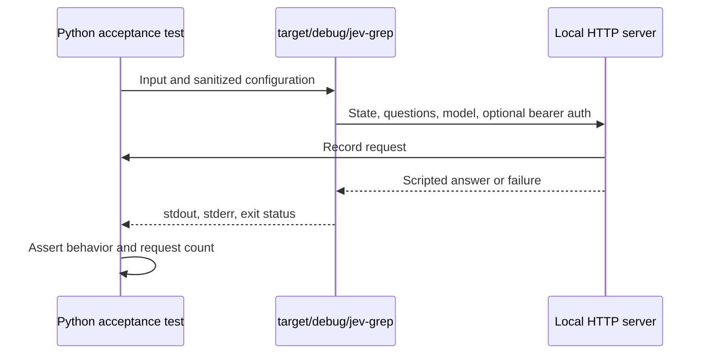

# Offline validation and behavioral regression map

## Choose evidence, not just a suite

The normal checks are **offline behavioral checks**: they exercise the client against controlled answers and local servers, without Zen credentials or model weights. They prove how the client handles a supplied probability or failure, not whether Jev understands a real query correctly. A prompt change can preserve every protocol assertion while changing live selection quality.

Follow [AGENTS.md](../../AGENTS.md): prefer the narrowest quiet validation that proves the changed behavior, and preserve complete failure output. Run commands below from the repository root. Expand to adjacent regressions when a change crosses input, API, search, or output boundaries.

| Evidence class | What it supports | What it does not support |
| --- | --- | --- |
| Rust tests and Python mock acceptance | Parsing, request/response contracts, state transitions, failure handling, coordinates, and CLI output under controlled responses | Real model accuracy, gateway availability, pricing, or context limits |
| Recorded synthetic live smoke | A documented release-binary integration run through fnox and Zen | A benchmark or representative quality result |
| `jev-quality-seed.jsonl` and backlog | Candidate scenarios and deferred evaluation planning | Executed results, measured accuracy, or implemented evaluation infrastructure |

## Test harness and prerequisites

Rust tests in `src/input.rs` use in-memory byte fixtures. API tests in `src/api.rs` bind local TCP listeners on ephemeral ports and inspect complete HTTP requests; they can deliberately send partial bodies, delay responses, or disconnect. This gives finer transport control than a model service.

Python [acceptance tests](../../tests/test_cli.py) launch **`target/debug/jev-grep`**, not a Cargo test executable or a release binary. Rebuild it after Rust changes:

```sh
cargo build --locked -q
PYTHONPATH=tests python3 -m unittest -q test_cli.CliTests.test_fragment_join_and_located_json
```

`clean_test_env` strips inherited `LG_*` and `JEV_GREP_*` variables, then applies explicit test overrides. The ordinary subprocess helper injects the local endpoint; configuration tests can disable that injection to check environment and flag precedence. Sanitization is scoped to those prefixes, not a completely empty environment.

Each `CliTests` setup starts a `ThreadingHTTPServer` on `localhost` with an ephemeral port. It records path, headers, and parsed JSON body. Tests can queue responses/statuses, supply raw HTTP bytes, or gate a response using threading events. Without an explicit scripted answer, the mock assigns high scores to `PKIX` matches and `join` continuations. Those rules are a deterministic test oracle, **not an imitation or measurement of Jev quality**.


*The acceptance harness exercises the real CLI with controlled model-side behavior.*

Python uses the standard library, but the TLS test additionally invokes `openssl` to create a temporary self-signed certificate. Streaming tests use `select` on subprocess stdout; use a compatible environment for these pipe-readiness checks.

## Focused regression map

The Rust filter syntax is `cargo test --locked -q FILTER`. For any Python row, first build as above, then use `PYTHONPATH=tests python3 -m unittest -q test_cli.CliTests.TEST_NAME`. Multiple fully qualified test names can be passed to the same invocation.

| Change category | Representative checks | Targeted selection |
| --- | --- | --- |
| Single/group API payloads and typed answers | `request_shapes_preserve_single_and_group_contracts`, `group_call_sends_one_request_and_parses_independent_answers`, `group_http_rejects_partial_or_invalid_answer_sets` | Rust filters `request_shapes` and `group_` |
| Retry classification, backoff, `Retry-After` | `retry_statuses_and_retry_after_values_are_bounded_safely`; Python `test_transient_http_retry_preserves_request_and_auth_and_caps_attempts` | Rust filter `retry_statuses`; Python named test |
| Partial-body disconnect and shared timeout | `partial_body_connection_reset_retries_same_request_once`, `drip_fed_body_cannot_extend_evaluation_deadline`, `repeated_body_disconnects_stop_within_shared_deadline` | Rust filters `partial_body`, `drip_fed`, `repeated_body` |
| Redirect, delayed response, response size | `transport_keeps_redirect_timeout_and_response_limit_rejected`; Python `test_malformed_and_oversized_complete_responses_are_not_retried` | Rust filter `transport_keeps`; Python named test |
| Credentials and CLI configuration | `test_environment_and_flag_precedence_and_required_model`, `test_new_environment_defaults_and_old_environment_is_ignored`, `test_zen_gateway_http_errors_include_status_without_fallback` | Python named tests |
| TLS trust failure | `test_tls_certificate_validation_failure_is_not_retried` | Python named test, with `openssl` available |
| Join threshold and saved relevance | `test_useful_context_at_equality_and_extended_relevance_change`, `test_declined_extension_does_not_replace_pending_score` | Python named tests |
| Group retry atomicity | `test_group_retry_commits_once_and_exhaustion_does_not_flush_pending` | Python named test |
| Physical bytes and decoded JSONL | `text_keeps_exact_bytes_crlf_and_eof_without_lf`, `jsonl_escaped_newlines_are_decoded_without_changing_physical_coordinates`; Python `test_raw_crlf_unicode_coordinates_and_text`, `test_decoded_jsonl` | Rust filter `input::tests`; Python named tests |
| Input bounds and invalid data | `rejects_nul_invalid_utf8_and_oversized_physical_lines`, `malformed_jsonl_shapes_and_decoded_nul_are_rejected`, `physical_line_and_byte_coordinate_overflow_are_checked` | Rust filter `input::tests` |
| Fragment limits and output modes | `test_fragment_split_and_cli_conflicts`, `test_human_and_json_select_the_same_fragment`, `test_count_list_quiet_invert_and_validation` | Python named tests |
| File walking and filters | `test_multiple_file_listing_and_walk_filters` | Python named test |
| Flush timing and downstream closure | `test_stream_boundary_emits_before_eof`, `test_broken_pipe_exits_cleanly`, `test_ast_grep_stdin_and_streams_before_jsonl_eof` | Python named tests |
| AST schema and coordinate fidelity | `test_ast_grep_fixture_preserves_upstream_candidate`, `test_ast_grep_rejects_bad_schema_ranges_and_oversized_candidates`, `test_ast_grep_rejects_reversed_or_inconsistent_columns_before_http` | Python named tests |
| AST counts, caps, and source identity | `test_ast_grep_upstream_source_accounting_and_limit_validation`, `test_ast_grep_count_first_seen_sources_and_empty_stream`, `test_ast_grep_files_with_matches_is_once_per_upstream_source`, `test_ast_grep_source_accounting_is_shared_across_input_files` | Python named tests, especially the cross-input regression |

For example, a transport-body deadline change warrants both slow-body and disconnect coverage rather than only a response parser test:

```sh
cargo test --locked -q drip_fed_body
cargo test --locked -q repeated_body
```

### Invariants these regressions protect

**API failures must not silently alter search state.** A group evaluation sends `current_fragment` and `next_record` and requires all four independent answers: `same_event`, `useful_context`, `match_next`, and `match_extended`. All are validated before returning to search. Joining occurs when either relation score reaches `--join-threshold`, including equality; an accepted extension replaces the pending relevance with `match_extended`, whereas a declined extension emits the old fragment using its saved score and initializes the next one with `match_next`.

Retries reuse the same request body and auth, with at most four total attempts and one evaluation budget covering requests, body reads, and waits. Complete malformed/oversized responses and TLS validation failures are not retried. The group-retry acceptance regression asserts a successful retried extension is emitted only once, and exhaustion does not flush the pending fragment. See [Zen API](../integrations/zen-api.md) for the full protocol boundary.

**Streaming must be observable, not inferred from final output.** `test_stream_boundary_emits_before_eof` keeps stdin open: one pending log record must remain silent, then a nonjoining record closes the boundary and makes output readable before EOF. The AST streaming test emits a complete independent candidate while its JSONL input remains open. The BrokenPipe test holds the third inference response behind an event gate, reads the first output, closes the downstream pipe, then releases the response to force the next write. It requires exit 0 and empty stderr; this exercises the CLI's clean BrokenPipe handling rather than relying on a scheduling race.

**Coordinates have different owners.** Raw text fixtures preserve CRLF, Unicode UTF-8 bytes, and EOF without LF. `log-jsonl` decodes escaped newlines for model text while retaining physical JSONL line/byte coordinates and `text_basis: decoded-records`. The [native AST fixture](../../tests/fixtures/ast-grep-native.jsonl) checks that output uses upstream `text`, `file`, optional `language`, and candidate ranges—not the `lines` context field or the JSONL transport location. AST byte offsets must match UTF-8 text length, while columns count Unicode characters. Invalid schema, inconsistent ranges/columns, and oversized candidates fail before inference. See [Located fragments](../concepts/located-fragments.md).

**AST accounting is invocation-wide, not transport-file-wide.** `run` owns a single `CodeSourceAccounting` passed into every search. Counts, first-seen ordering, `-l` deduplication, and `-m` caps are keyed by the upstream candidate `file` across all physical inputs. A capped source is still parsed and size-checked, but does not trigger another inference. Other sources remain evaluable. The cross-input regression repeats `src/A.rs` in two JSONL files and verifies the cap survives the second file while `src/B.rs` still gets evaluated. See [Code candidates](../workflows/code-candidates.md) and [Log fragments](../workflows/log-fragments.md) for the distinct evaluation flows.

## Release-tooling checks

Use Node.js 24.10+ and installed locked dependencies. The full offline release test entrypoint is:

```sh
npm ci
npm run test:release
```

For narrower checks, Node's test-name filter can select the relevant group:

```sh
node --test --test-name-pattern='release classification|highest release type' scripts/release.test.mjs
node --test --test-name-pattern='version update|invalid version|prepare blocks' scripts/release.test.mjs
node --test --test-name-pattern='semantic-release plans' scripts/release.test.mjs
```

These tests cover Conventional Commit classification and highest-bump selection; version updates that preserve other manifest/lockfile content and are harmless to reapply; invalid versions or inconsistent lockfiles failing without partial writes; and prepare rejecting version drift or missing platform assets before modifying Cargo files. The end-to-end tooling test uses a temporary Git repository and local bare remote: a dry run does not create the next tag, then publication tags the planned Cargo version and pushes the version commit locally. Asset files are placeholders, so this is not archive-content verification or a real GitHub publication test. See [Releases and automation](../operations/releases-and-automation.md).

## Broader checks and evidence limits

After focused validation, use the documented broader checks when appropriate:

```sh
cargo test --locked -q
cargo build --locked -q
python3 -m unittest discover -s tests -q
cargo fmt --check
cargo clippy --locked --all-targets -- -D warnings
```

The [development guide](../../docs/development.md) gives the verbose acceptance variant. Do not truncate failures merely to make output quiet.

The [deployment guide](../../docs/deployment.md#minimal-live-integration-smoke) records a **2026-09-28** smoke using `cargo build --locked --release`, fnox keychain launch, `jev-1.13`, and `https://opencode.ai/zen/v1/systemone`. One synthetic AST candidate exited 1 with no selected fragment and no API/input error. A two-record text scenario exited 0 and emitted the first record, continuing through the second and grouped assessment before EOF. Each scenario ran once; no benchmark, latency, usage statistics, or model-quality claim was collected. Treat this as a recorded integration result, not a new run performed by this page.

The [quality seed](../../tests/fixtures/jev-quality-seed.jsonl) includes synthetic compiler/stacktrace, recovery, neighboring-context, independent-error, byte-edge, long-input, AST, and mixed-language scenarios. The [backlog](../../docs/BACKLOG.md) explicitly calls it **unexecuted** and defers representative case selection, selection boundaries, prompt wording, language coverage, and reproducibility. Scenario names or labels are not measured Jev outcomes; a long-input example does not establish a gateway context limit. Use authorized synthetic data for any future live testing, and keep integration success separate from quality evaluation.
