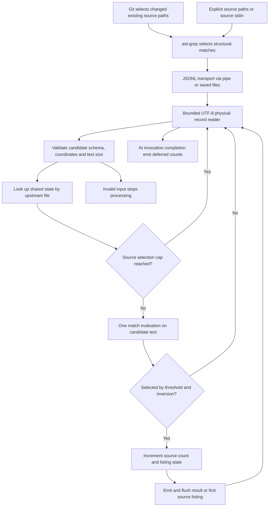

# AST candidate search and upstream source accounting

`ast-grep` owns structural selection; `jev-grep --input-format ast-grep` owns semantic evaluation. The boundary is **`ast-grep scan --json=stream`**, with one JSON object per match on a physical JSONL line. The consumer does not parse syntax trees, Git diffs, or source files: it validates the supplied candidate and asks whether its `text` meets the natural-language criterion.

This differs from [log fragment assembly](log-fragments.md): code candidates are already bounded upstream and never enter the adjacent-record grouping path. See [located fragments](../concepts/located-fragments.md) for the common output model and [Zen API integration](../integrations/zen-api.md) for inference transport.

## End-to-end flow


*Flow of code candidates from upstream selection through transport validation, source-keyed accounting, inference, and output. Count mode defers output, and quiet mode stops at the first selected candidate.*

`main::run` creates one `CodeSourceAccounting` for the entire invocation and passes it into every `search` call. `search` constructs a separate bounded `Reader` for each physical input, then takes the AST-specific branch for every record. Parsing and size checks precede the source-cap check; an uncapped candidate gets one `Api::probability` evaluation with the single `match` question and its exact `text` as state. Evaluations are sequential, not batched. Transport retries may cause more than one HTTP attempt for that one logical evaluation.

The branch emits selected candidates directly and continues to the next record. It never creates a pending code fragment or calls `group_probabilities`; `--join-threshold` has no grouping effect in this mode. Ordinary human/JSON results and newly listed sources are flushed immediately, without waiting for the next candidate or transport EOF. This is consumer-side streaming: when ast-grep itself receives source code through `--stdin`, it reads that code until EOF before supplying candidates. [Repository guide](../../docs/code-search.md)

## Transport contract and validation

Required fields are:

| Field | Contract |
| --- | --- |
| `text` | String containing the selected node text, with no decoded NUL |
| `file` | Nonempty string identifying the upstream source |
| `range.byteOffset.start/end` | Nonnegative integer offsets, ordered and differing by the UTF-8 byte length of `text` |
| `range.start.line/column`, `range.end.line/column` | Nonnegative integers whose line and column spans agree with `text` |
| `language` | Optional string; if supplied, preserved in JSON output |

Unknown fields, including `lines`, `labels`, and `metaVariables`, do not supply evaluated content. **`text`, not `lines`, is the structural match**: context can include code outside the selected node and would change the question being evaluated. Nested, overlapping, adjacent, and duplicate nodes remain separate candidates; there is no deduplication, overlap resolution, or merging. Change the upstream rule if that selection is undesirable.

The parser checks that the zero-based end line equals the start line plus the number of LF bytes in `text`. Columns count Unicode characters, whereas byte offsets count UTF-8 bytes. For a single-line candidate, the end column must equal the start column plus its character count; for multiline text it must equal the final line's character count. Coordinates must not overflow during conversion.

JSON arrays from `--json` or `--json=compact`, `outline` objects, malformed JSON, absent/wrongly typed fields, inconsistent ranges, invalid UTF-8, and NUL bytes are errors, not candidates to skip. Diagnostics identify the **transport name and physical JSONL line**, even though successful output uses the upstream source location. Validation establishes internal consistency only: source files are not reopened, and stale offsets or a changed/deleted source after extraction cannot be detected. A saved candidate stream can therefore be queried without its source tree present. [Parser](../../src/input.rs)

### Two independent size limits

Both defaults are `16384` bytes:

- `--max-line-bytes` bounds the serialized physical JSONL record, including its line ending, before candidate decoding. The reader retains at most the configured limit plus one overflow-detection byte.
- `--max-fragment-bytes` bounds decoded candidate `text` in UTF-8 bytes. An oversized AST node fails; it is not split into smaller fragments.

ast-grep may repeat content in `text`, `lines`, and `labels`, so a valid node can serialize to a much larger record. The examples use `--max-line-bytes 262144` without changing the body limit. Raise the body limit deliberately or choose smaller nodes upstream; increasing client byte limits does not increase the model's token context.

## Accounting follows the upstream source, not the transport

The shared state has an exact-string `file` lookup plus a first-seen ordered collection containing each source's selected count and whether it has been listed. Consequently `src/A.rs` and `./src/A.rs` are distinct keys; the consumer does not canonicalize paths.

| Option | Code-mode behavior |
| --- | --- |
| `--threshold P` | Select probability ≥ P, default `0.5` |
| `-v` | Select probability below the threshold instead |
| `-m N` | Cap selected candidates per upstream `file` across the whole invocation, not evaluations or JSONL files |
| `-c` | At successful invocation completion, print `source:count` in first-seen source order, including encountered sources with zero selections |
| `-l` | Print each selected upstream source once, immediately; subsequent candidates are still evaluated unless capped |
| `-q` | Suppress output and stop the invocation on the first selection |

For interleaved `A, B, A`, selecting the first `A` with `-m 1` suppresses inference on the second `A`, while `B` still gets evaluated. The same rule applies when those candidates are split between several JSONL files or stdin and files. Even after a cap, records continue through physical-input, schema, coordinate, and text-size validation; malformed later candidates can still fail the invocation. Unlike quiet mode, the code-mode cap does not stop reading the transport.

Counts describe selected **candidates**, not unique ranges or functions. Duplicate selected candidates count separately. Sources that supplied no candidates are unknown and absent from counts; an empty stream prints nothing and returns no-match status. `-l` deduplicates output names, not candidate processing. Accounting memory grows with encountered source keys. [Accounting and emission](../../src/search.rs)

## Located output and stdin identity

`--format json` (or `--json`) emits selected candidates as `kind: "code"`, with `source`, converted `range`, unchanged `text`, `text_basis: "source"`, the criterion `probability`, and optional `language`. Both split flags are always `false`. Lines become one-based inclusive coordinates; a trailing LF does not add the next empty line to the displayed range. Byte boundaries remain zero-based half-open upstream offsets, not positions in the JSONL file.

Human output always includes `source:start-end bytes start-end`, followed by candidate text. It adds a final LF for readability when needed; JSON preserves the text without that addition.

Only the exact upstream `file: "STDIN"` marker maps to JSON `{"kind":"stdin","path":null}` and human `(stdin)`. Count and list modes retain the literal key `STDIN`. A JSONL pipe containing `file: "src/main.rs"` still produces a file source; conversely, saving a `STDIN` candidate to disk does not restore the original source filename. To preserve a filename, pass that file directly to ast-grep rather than piping its contents through `--stdin`.

## Running and narrowing the search

From a Rust project root:

```bash
set -o pipefail

ast-grep scan --json=stream --inline-rules '
id: rust-functions
language: Rust
severity: hint
rule:
  kind: function_item
' ./src |
  jev-grep --input-format ast-grep --max-line-bytes 262144 --format json \
    'Function that validates input or rejects malformed data'
```

Configure API credentials before running; for Zen, the repository guide uses `fnox exec -- jev-grep ...`. `severity: hint` extracts candidates without an error-level rule's nonzero status merely because matches exist. Language-specific node kinds or a `--rule rule.yml` are the structural extension point. Saved streams can be reused with different semantic criteria:

```sh
jev-grep --input-format ast-grep --max-line-bytes 262144 \
  'Code that handles authentication failures' candidates.jsonl
```

**CLI `-g`, `--hidden`, and `--no-ignore` select transport files**, not candidate `file` values. With a directory of saved JSONL files, use those options to control which JSONL inputs are opened. Select source extensions, ignored files, and structural boundaries in ast-grep instead. [CLI traversal](../../src/main.rs)

### Changed-file Git pipeline

This Bash pipeline checks Git separately, preserves path boundaries with NUL delimiters and an array, and avoids invoking ast-grep with an empty path list:

```bash
set -e
set -o pipefail

tmp=$(mktemp)
trap 'rm -f "$tmp"' EXIT

if ! git diff --name-only -z --diff-filter=ACMRTUXB HEAD -- >"$tmp"; then
  echo 'git diff failed' >&2
  exit 2
fi

files=()
while IFS= read -r -d '' path; do
  [[ $path == *.rs && -f $path ]] && files+=("./$path")
done < "$tmp"

if ((${#files[@]})); then
  ast-grep scan --json=stream --inline-rules '
id: rust-functions
language: Rust
severity: hint
rule:
  kind: function_item
' -- "${files[@]}" |
    jev-grep --input-format ast-grep --max-line-bytes 262144 \
      'Function that handles an error or validates input'
fi
```

This compares tracked index/working-tree changes against `HEAD` but scans the **current working versions of all functions in changed, existing `.rs` files**, not just changed hunks. Untracked files are excluded; deleted files and the deleted side of a diff are not analyzed, so removed behavior is invisible. The empty branch is essential because ast-grep without paths may scan its default directory. Git process substitution would hide Git's exit status; checking its temporary-file output first prevents Git failure from proceeding to scanning or inference.

`jev-grep` cannot infer the upstream process's exit status from JSONL EOF. Use Bash `pipefail`, and distinguish pipeline status from consumer status: the consumer returns `0` for any selection, `1` for no selection, and `2` for input/options/API errors, with broken downstream pipes treated as clean exits. A failed producer may leave valid partial candidates that were already evaluated and emitted; later errors do not retract output. Quiet early exit can also close the pipe and cause upstream SIGPIPE. [Pipeline semantics](../../docs/reference.md#exit-codes-and-pipelines)

## Focused regression coverage

[CLI tests](../../tests/test_cli.py) exercise the contract with a local HTTP stub, not a semantic-quality guarantee:

- `test_ast_grep_fixture_preserves_upstream_candidate` uses the [native fixture](../../tests/fixtures/ast-grep-native.jsonl) to assert exact CRLF/Unicode text, upstream bytes and lines, optional language, and model state excluding `lines`.
- `test_ast_grep_stdin_and_streams_before_jsonl_eof` keeps stdin open after writing a complete candidate and asserts immediate output plus the `STDIN` mapping.
- Schema/range/size and column-validation tests assert errors before HTTP inference.
- Interleaved-source, first-seen-count, once-per-source-listing, and multiple-input tests verify shared limits and counts, including validation after a source is capped.

These are the key invariants to preserve when changing the reader, AST parser, search loop, or accounting owner. Broader test scope is covered in [validation](../testing/validation.md).
