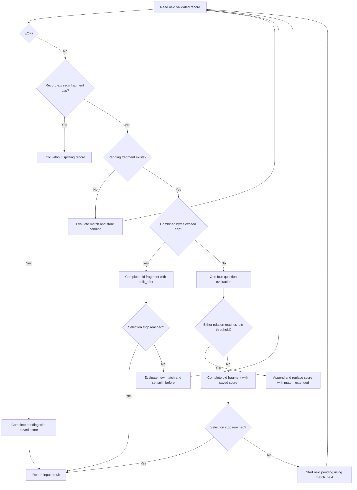

# Streaming log grouping and selection

`jev-grep` does not select each log line independently. For `text` and `log-jsonl`, it keeps one **pending fragment** and its current relevance score, then asks the model whether each adjacent record belongs with it. Selection happens only when the fragment completes. This lets a stack trace provide context and a recovery message change whether an earlier failure satisfies an “unresolved failure” criterion.

The workflow is implemented by [`search`](../../src/search.rs), with bounded record reading in [`Reader`](../../src/input.rs), span-preserving assembly in [`Fragment`](../../src/fragment.rs), and model evaluations in [`Api`](../../src/api.rs). `ast-grep` takes a separate independent-candidate branch: see [Code candidates](code-candidates.md), not this grouping lifecycle.

## Inputs and state ownership

The CLI calls `search` separately for each file or explicit stdin input. Each call creates a fresh reader, `pending: Option<(Fragment, f64, bool)>`, selected-fragment counter, and found flag. The tuple holds the assembled fragment, its saved score, and whether it began after a forced split. **Records never join across inputs**, and `-m` limits log selections per input, not across the whole invocation. The caller combines the found results and handles invocation-wide quiet stopping.

With no paths, redirected stdin is selected; a terminal invocation defaults to `.`. `-` explicitly selects stdin, and explicit paths do not implicitly add stdin. These choices determine which received stream owns the coordinates.

| Input format | One record | Model-visible and assembled text | Location basis |
| --- | --- | --- | --- |
| `text` | One physical line, or the final unterminated line | Original UTF-8 text, including its LF or CRLF when present; appends add no separator | Exact source bytes |
| `log-jsonl` | One physical JSON object line containing string `text` | Decoded `text`; appends insert exactly one additional LF between records | Physical JSONL lines and bytes, not decoded text offsets |

For JSONL, escaped `\n` can make one record multiline without changing its physical line count. Extra fields such as `level`, `task`, `source`, and `range` are ignored, neither evaluated nor adopted as coordinates. Put relevant metadata inside `text`. Arrays, blank physical lines, invalid JSON, missing or non-string `text`, invalid UTF-8, and physical or decoded NUL are errors. Plain text also rejects invalid UTF-8 and NUL.

Locations use **1-based inclusive lines** and **0-based half-open byte ranges**. Appending advances the fragment's end to the appended record's physical end. For JSONL, `text_basis: decoded-records` warns that the displayed text is not an exact byte slice of that range; for text, `text_basis: source` preserves that relationship. See [Located fragments](../concepts/located-fragments.md) for the output contract.

Sources: [reader validation and coordinates](../../src/input.rs#L129-L238), [assembly](../../src/fragment.rs#L23-L63), [input dispatch](../../src/main.rs#L111-L178).

## Pending-fragment control flow


*Pending-fragment branching flow: size guards precede semantic grouping, and only completion triggers selection and early-stop checks.*

### Initial evaluation and the boundary request

The first record receives a standalone `match` evaluation through `Api::probability`. It becomes pending even if its score is below the selection threshold: later context can change relevance.

When there is a pending fragment and the next record fits the combined byte cap, `Api::group_probabilities` makes **one logical HTTP evaluation with four typed questions**, using `current_fragment` and `next_record` as state:

| Question | Responsibility |
| --- | --- |
| `same_event` | Does the new record continue the same concrete event? A shared topic is insufficient. |
| `useful_context` | Does it materially explain, qualify, resolve, or contradict the fragment with respect to the query? Independently matching the query is insufficient. |
| `match_next` | Does the new record match by itself, ignoring the fragment? |
| `match_extended` | Does the fragment followed by the new record match as a whole? |

The join decision is `same_event >= join_threshold OR useful_context >= join_threshold`. Equality joins; either relation suffices. Both thresholds default to `0.5`, but `--join-threshold` controls grouping while `--threshold` controls selection.

- **Join:** append the record, preserve `split_before`, and replace the saved score with `match_extended`. A successful retry or resolving message can lower the final score and suppress an earlier error.
- **Reject:** complete the old fragment using its **stored score**, not `match_extended`. If processing continues, start a new fragment from the next record using `match_next`, without another standalone request; its `split_before` is false.
- **EOF:** complete any pending fragment with its stored score, without another model evaluation. Empty input creates no pending fragment and selects nothing.

All four answers must be numeric, finite probabilities in `[0, 1]` before the grouping call returns. Partial or invalid answers cannot be used to commit an append or emit a semantic boundary. An evaluation error propagates rather than flushing pending text as though EOF occurred. Already completed output is not rolled back.

Sources: [question construction and validation](../../src/api.rs#L44-L85), [probability validation](../../src/api.rs#L273-L284), [state transitions](../../src/search.rs#L132-L220).

### Forced splits happen before grouping

Two independent limits default to `16384` bytes:

- `--max-line-bytes` bounds a **physical input line including its ending**. The reader consumes at most the limit plus one byte to detect overflow. For JSONL this measures the serialized object, not just decoded `text`.
- `--max-fragment-bytes` bounds evaluated and assembled UTF-8 text. For a JSONL append, the size calculation includes the additional LF separator; plain text already contains its separators.

A single record whose evaluated text exceeds the fragment cap is **indivisible and errors** with `record exceeds --max-fragment-bytes`. It is not chopped into substrings. This check happens before finishing an existing pending fragment, so an oversized next record does not automatically flush the old one.

For a valid next record, if `pending text bytes + separator bytes + next text bytes > max_fragment_bytes`, the program skips the four-question grouping request entirely. It completes the old fragment with `split_after: true` and its saved score. If no selection stop applies, it evaluates the new record with a fresh standalone `match` and starts pending with `split_before: true`. These flags indicate a mechanical truncation of grouping opportunity, not a model-confirmed semantic boundary. A fragment can carry both flags after consecutive forced splits.

**Reaching the exact cap does not complete a fragment.** The comparison is strictly `>`, checked only when another record arrives. A fragment at the cap still awaits a later boundary, overflow attempt, or EOF. Even after a permitted append reaches the exact cap, there is no immediate emission.

Source: [record and combined-size guards](../../src/search.rs#L132-L162), [physical-line bound](../../src/input.rs#L158-L179), [defaults and validation](../../src/main.rs#L71-L110).

## Selection, output, and early stopping

`emit` is the common completion path for size splits, rejected joins, and EOF. Normally a completed fragment is selected when `saved probability >= threshold`; `-v` selects the complement, strictly below the threshold. The selected counter increments only for selected **completed fragments**, not lines, records, or successful joins.

| Option | Log behavior |
| --- | --- |
| Normal human or JSON output | Write each selected completed fragment and flush stdout immediately. JSON rows are `kind: log` with source, range, text basis, probability, and split flags. |
| `-c` / `--count` | Suppress fragment bodies and print `name:selected` at EOF or a selected-count stop, then flush. |
| `-m N` / `--max-count N` | Stop the current input after N completed selections; later inputs get fresh counters. N must be positive. |
| `-l` / `--files-with-matches` | Print and flush the input name on its first completed selection, then stop that input; continue other inputs. |
| `-q` / `--quiet` | Produce no result output and stop the invocation on the first completed selection. |

On a rejected semantic join, the boundary request has already evaluated the next record before any stop is possible. If a stop applies, the program returns before installing the next pending fragment. On a forced split, stopping happens **before** the fresh standalone evaluation of the next record. Thus `-m 1` can require a boundary record and its four-question evaluation; it cannot stop just because the first pending score looks selected.

Sources: [completion stops](../../src/search.rs#L145-L205), [selection and serialization](../../src/search.rs#L316-L395), [invocation quiet stop](../../src/main.rs#L162-L178).

## Live streams and shell preprocessing

### A pause is not a boundary

```bash
set -o pipefail

./gradlew --console=plain build 2>&1 |
  jev-grep 'Build failure caused by dependencies or certificate validation'

tail -f application.log |
  jev-grep 'Connection failure that was not resolved by a retry'
```

`2>&1` merges the producer's stdout and stderr. An idle live stream does not complete a pending fragment, even if its current score matches. The reader waits for more data; completion requires a rejected join, forced split, or EOF. Completed selections are flushed, but a stream that never supplies a boundary can leave a fragment pending indefinitely. `--timeout` defaults to 30 seconds and budgets a **model evaluation**, including request sending, response reading, retries, and waits; it is not an input-idle timeout.

One logical boundary evaluation may produce multiple HTTP attempts on transient failures, up to four total attempts within that budget. Retries preserve the request, and a successful grouping result is committed once. See [Zen API integration](../integrations/zen-api.md) for transport details.

Stdin locations start at the beginning of the **received stream**. `tail -f` does not send the complete file history, so result line numbers are not full-file line numbers. Search the saved file directly when original-file coordinates are required.

### agrind prepares records, not semantic fragments

[Angle Grinder](https://github.com/rcoh/angle-grinder) is an independently installed producer (`agrind`). For JSONL with string `message`, rename that field to the required `text`:

```bash
set -o pipefail

agrind --output json '* | json | message as text | fields text' < app.jsonl |
  jev-grep --input-format log-jsonl --format json 'Certificate validation failure'
```

If string `level` matters, include it in evaluated text:

```bash
agrind --output json \
  '* | json | concat(level, ": ", message) as text | fields text' < app.jsonl |
  jev-grep --input-format log-jsonl 'Unresolved application error'
```

For plain text wrapping:

```bash
agrind --output json '* | parse "*" as text noconvert' < build.log |
  jev-grep --input-format log-jsonl 'Dependency resolution failure'
```

`noconvert` preserves numeric-looking values as strings. However, `parse` strips leading and trailing whitespace, including stack-trace indentation. Direct text input is preferable when exact preservation matters. Do not prefilter only error records if continuations or recovery context are needed: agrind's `json` drops invalid JSON lines, and `parse` without `nodrop` drops unmatched lines. **The consumer cannot detect upstream losses or transformations.** It can validate only the stream it receives; adjacent surviving JSONL records still undergo semantic grouping.

To obtain a file corresponding to reported JSONL coordinates, save the prepared stream and search it:

```bash
agrind --output json '* | json | message as text | fields text' < app.jsonl > prepared.jsonl
jev-grep --input-format log-jsonl 'Certificate validation failure' prepared.jsonl
```

The result names `prepared.jsonl`; extra JSON metadata cannot carry over the original `app.jsonl` location.

### Consumer status is not pipeline status

`jev-grep` exits `0` for a selection, `1` for none, and `2` for an error; a broken stdout pipe is treated as clean exit `0`. Early stopping through `-q`, `-l`, or `-m` can close the input pipe while the producer is still writing, potentially giving that producer SIGPIPE. Bash `pipefail` also makes producer failures affect the pipeline status. Therefore, distinguish the consumer's exit code from the whole pipeline's status: a nonzero pipeline status does not by itself prove a consumer failure or no selection.

<!-- openwiki: broken internal link [../../docs/logs.md#L38-L182] heading anchor "L38-L182" does not exist in "../../docs/logs.md". Fix the href or restore the target, then delete this comment. -->
Sources: [live-stream and agrind guidance](../../docs/logs.md#L38-L182), [evaluation budget](../../src/api.rs#L87-L184), [exit handling](../../src/main.rs#L186-L204).

## Focused validation and change safety

The offline CLI suite uses a local HTTP server with controlled scores and captured requests. It verifies mechanism and output, not the real model's semantic accuracy. Useful checks when changing this workflow include:

- `test_fragment_join_and_located_json`: a joined fragment's text/range and the four question names.
- `test_useful_context_at_equality_and_extended_relevance_change`: useful context alone joins at equality and can remove selection.
- `test_declined_extension_does_not_replace_pending_score`: rejection retains the old probability despite a high `match_extended`.
- `test_fragment_split_and_cli_conflicts` and `test_count_list_quiet_invert_and_validation`: forced-split flags and stopping after completed selections.
- `test_stream_boundary_emits_before_eof`: a pause produces no output, then a rejected join flushes before EOF.
- `test_group_retry_commits_once_and_exhaustion_does_not_flush_pending`: retries do not duplicate assembly and exhaustion does not emit pending text.
- Reader unit tests cover CRLF, Unicode byte ranges, unterminated EOF lines, decoded newlines, malformed JSONL, and physical-line limits.

Run `cargo test`, then `cargo build` and `python3 -m unittest discover -s tests`. Preserve the ordering **validate record → check combined size → evaluate grouping → complete/select or append** when modifying the loop; moving selection or size checks changes observable request counts, pending-score semantics, and live-stream behavior. See [Validation](../testing/validation.md) for broader testing context.

Sources: [CLI acceptance tests](../../tests/test_cli.py#L232-L381), [live-stream test](../../tests/test_cli.py#L525-L543), [retry test](../../tests/test_cli.py#L174-L188), [reader tests](../../src/input.rs#L257-L333).
